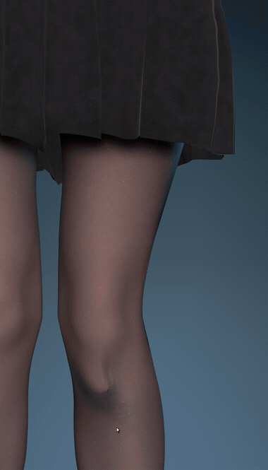
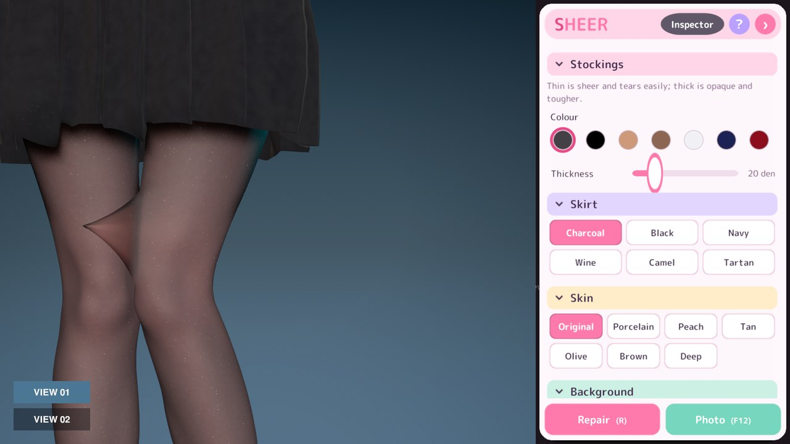
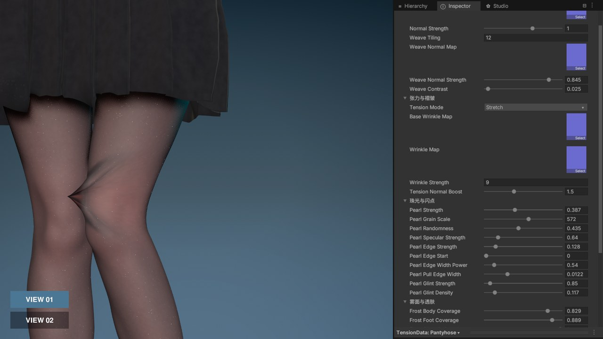
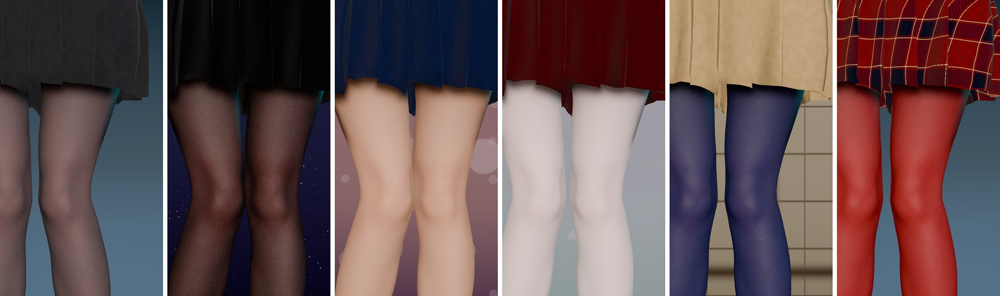

  

<h1 align="center">SHEER</h1>

  <b>A real-time sheer-tights simulator.</b> Grab the nylon anywhere, on either leg, and pull: 
  it stretches sheer, tents into sails, springs back, and tears into holes and ladders that run along the knit. 
  Unity 6 · HDRP · GPU cloth · Windows & Linux

  <a href="../../releases/latest"><b>⬇ Download (Windows / Linux)</b></a>
  &nbsp;·&nbsp; <a href="docs/img/showreel.mp4">Showreel</a>
  &nbsp;·&nbsp; <a href="docs/TECH.md">How it works</a>

  
  

## What it is

A real-time take on 樱花兔 (Sakura Rabbit)'s Unity pantyhose demo, rebuilt from the ground up.

- **The nylon is a real cloth simulation.** Each leg of the pantyhose is a pre-stretched knit membrane on the GPU, a
  256 × 400 lattice from the toes to the thigh, at 3840 substeps a second. A pinch gathers the fabric under your
  fingers, draws it out into a sail, and lets it spring back. Slide the pinch over the leg and the fabric around it
  slides along; a hole or ladder beside your fingers stretches toward them, since there's no knit across it to grip.
- **It tears like nylon.** Pull too far or hold too long and it gives way. Holes open with torn lips and loose
  threads, and ladders race up and down the wales, over the ankle and along the foot, and stop at the reinforced toe.
  Shift-click to snag it with a fingernail.
- **The skirt is cloth too.** It hangs from the waist, rests on her hips and thighs, swings when she shifts her
  weight, and lifts a little in the breeze from below.
- **She never stands still.** She shifts her weight from leg to leg, turns her knees in, fidgets and lifts a big toe,
  like someone waiting on her feet.
- **The original's panel is here.** `TensionData: Pantyhose`, rebuilt from measurements of the original video
  (press **I**). Every slider, number and menu in it changes the stockings live; hover a label to see what it does.
  (The original's texture slots and material flags, which had nothing to change here, are left out.)

## The panel

A small side panel (**Tab**) with what you'd change on a set, and nothing that gets in the way of the nylon:

- **Stockings**: seven colours, and the thickness from a whisper-thin 8 denier to an opaque 80. Thicker is darker and
  tougher to tear.
- **Skirt**: charcoal, black, navy, wine, camel or grey.
- **Skin**: seven tones.
- **Background**: the original's studio, dusk, night, pastel, shoji or a gym.
- **Sound**: six original tracks made for the game (lo-fi, future bass, chiptune, music box, city pop, koto), or none;
  the nylon creaks, rips and zips.

The panel scales with the window, and every section folds away.

## Play

Download the archive for your system from **[Releases](../../releases/latest)** (`Sheer-Windows-x64.zip` or
`Sheer-Linux-x64.tar.gz`), unpack it and run `Sheer.exe` (Windows 10/11) or `Sheer.x86_64` (Linux, Vulkan). You need
a DirectX 12 / Vulkan GPU; the game was developed on an RTX 3060. The first start shows a loading screen for 10–20 s
while the shaders are prepared. The game isn't code-signed, so Windows may say it "protected your PC": click
**More info → Run anyway**.

| | |
|---|---|
| **Left drag** on the tights | pinch and pull; pull far or hold long and it tears |
| **Shift + click** | a fingernail snag |
| **Right drag** · **wheel** | orbit · zoom |
| **1 / 2** | VIEW 01 / VIEW 02, the original video's cameras |
| **R** | repair: the tears mend |
| **Tab** · **I** · **H** | the panel · the original's panel · hide all UI |
| **F12** · **M** · **Space** | photo · music · pause |
| **Ctrl+Z / Y** | undo / redo a change of the look |
| **P** · **F1** | replay the original video's session on the simulator · help |

## Under the hood

Cloth, tearing, shaders, performance and how to build it: **[docs/TECH.md](docs/TECH.md)**.

## Credits

- Inspired by the Unity 6 pantyhose demo of **樱花兔 (Sakura Rabbit)**. This is an independent recreation; no code or
  assets from the original were used.
- Body: Blender Studio *Human Base Meshes* (CC0).
- Fonts: M PLUS Rounded 1c and Inter (SIL Open Font License; the licences ship with the game).
- Tonemapping: a LUT baked from Blender's AgX view transform (AgX by Troy Sobotka; Blender's version by Eary Chow,
  Mark Faderbauer and Sakari Kapanen).
- Music and sound effects: original, synthesized for this project.

## Licence

MIT (see [LICENSE](LICENSE)), except the third-party material in [THIRD_PARTY_NOTICES.md](THIRD_PARTY_NOTICES.md): the
tonemapping LUT (GPL-3.0-or-later, from Blender) and the fonts (SIL Open Font License).
